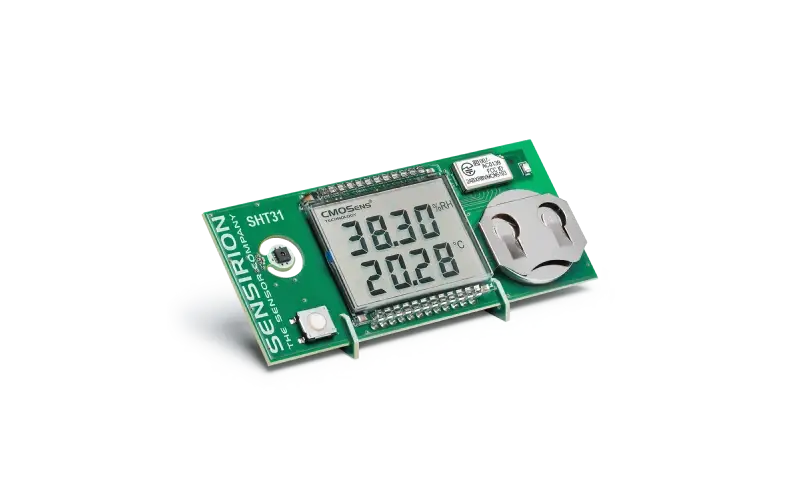

# Sensirion SHT31 Smart Humigadget for Home Assistant

[](https://hacs.xyz/)
[](https://github.com/AeddinPL/sht31-humigadget-ha-integration/releases)
[](https://opensource.org/licenses/MIT)


A custom Home Assistant integration for the **Sensirion SHT31 Smart Gadget (BLE: Smart Humigadget)**. 
It reads sensor data over Bluetooth Low Energy (BLE) using an active GATT connection. This integration was initially developed for personal use and has not been extensively tested across different hardware configurations.
[https://sensirion.com/products/catalog/SHT31-Smart-Gadget](https://sensirion.com/products/catalog/SHT31-Smart-Gadget)

<p align="center">
  
</p>

## Why this integration?

The older SHT31 Smart Gadget does not include its measurements in BLE advertisement packets. It advertises basic discovery information and the local name `Smart Humigadget`, but temperature and humidity must be read through a GATT connection.

This integration connects to the device, reads its measurements and battery level, and disconnects after each update. This avoids keeping a BLE connection open between polls.

## Features

The integration creates the following sensors:

| Sensor | Unit | Description |
| --- | --- | --- |
| Temperature | °C | Temperature reported by the SHT31 |
| Humidity | % | Relative humidity reported by the SHT31 |
| Dew point | °C | Calculated from temperature and relative humidity |
| Absolute humidity | g/m³ | Calculated water-vapour mass per cubic metre of air |
| Heat index | °C | Calculated apparent temperature based on temperature and relative humidity |
| Battery | % | Battery level; diagnostic entity |

Derived values are calculated locally from the temperature and relative humidity readings:

- **Dew point** and **absolute humidity** use Magnus-based humidity calculations.
- **Heat index** uses a simplified estimate at lower temperatures and the NOAA regression, including its low- and high-humidity adjustments, when the calculated average reaches 26.7 °C.
- Relative humidity is clamped to the 0–100% range for these calculations. Derived values are rounded to two decimal places.

The battery reading is optional. If it cannot be read, the other sensor values can still be updated.

The integration supports Home Assistant's Bluetooth integration, including local Bluetooth adapters and ESPHome Bluetooth Proxies.

## Installation

### HACS (recommended)

1. Make sure [HACS](https://hacs.xyz/) is installed.
2. Open **HACS → Integrations**.
3. Open the menu in the top-right corner and select **Custom repositories**.
4. Add this repository:
   `https://github.com/AeddinPL/sht31-humigadget-ha-integration`
5. Select **Integration** as the category and add the repository.
6. Find **Sensirion SHT31 Smart Gadget** and download it.
7. Restart Home Assistant.

### Manual installation

1. Download the ZIP archive from the [GitHub Releases](https://github.com/AeddinPL/sht31-humigadget-ha-integration/releases) page.
2. Copy `custom_components/sht31_humigadget/` into the `custom_components` directory of your Home Assistant configuration:
   ```text
   /config/custom_components/sht31_humigadget/
   ```
3. Restart Home Assistant.

## Configuration

### Automatic discovery

If Home Assistant's Bluetooth integration can detect the device, the integration will appear under **Settings → Devices & services**. Select **Configure** and follow the setup flow.

### Manual setup

1. Go to **Settings → Devices & services**.
2. Select **Add integration**.
3. Search for **Sensirion SHT31 Smart Gadget**.
4. Enter the sensor's Bluetooth MAC address (for example, `F3:15:B7:5E:61:C2`). You can also provide an optional device name.
5. Submit the configuration.
   
## Sensirion SHT31 Smart Gadget documentation

[User Guide](https://sensirion.com/media/documents/429F0DF6/61643DC1/Sensirion_Humidity_Sensors_SHT3x_Smart-Gadget_User-Guide_1.pdf)
[Software](https://github.com/Sensirion/SmartGadget-Firmware/tree/master)
[Hardware](https://github.com/Sensirion/SmartGadget-Hardware)

## Troubleshooting

**The sensor is not discovered or the connection fails:**

- Make sure Bluetooth is enabled on the SHT31 Smart Gadget. The Bluetooth symbol should be visible on its display. If it is not, press and hold the button on the device for approximately two seconds.
- Close the Sensirion MyAmbience app or disconnect the phone from the sensor. The device may not accept another connection while the phone is connected.
- Check the CR2032 battery. A weak battery can cause connection problems.
- Move the sensor closer to the Home Assistant Bluetooth adapter or Bluetooth Proxy during setup and testing.

## License

This project is licensed under the [MIT License](LICENSE).
